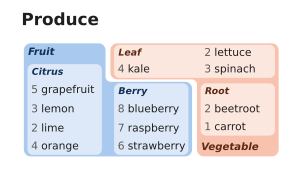

# Render


<!-- WARNING: THIS FILE WAS AUTOGENERATED! DO NOT EDIT! -->

Each group, at every depth, is drawn as one flat-coloured, rounded
rectilinear shape holding its header and its names. Top-level groups get
distinct hues, chosen so that neighbouring groups never share one;
nested groups are lighter shades of their parent’s hue, so a subgroup
reads as a pale panel set into its parent.

Headers are told apart from names without relying on the names’ own
typography, since gene and protein names follow different case and
italic rules in different organisms:

- header text is the only coloured text (a dark shade of its group’s
  hue), and is set heavier;
- by default headers take the **opposite slant** to the names: italic
  names (bacterial gene symbols, say) get roman headers, and roman names
  get italic headers.

An item may carry a **numeral**, drawn in grey before its name and
right-aligned in its own column so that digits line up.

## Sizes

[`prepare`](https://adamcc.github.io/itemiset/treemap/render.html#prepare)
measures every name and header label in the font, and decides:

- the **cell width**: the widest numeral, a gap, and the widest name,
  plus room for the insets of the deepest nesting level (headers never
  widen cells);
- each header’s **span**: the fewest cells (up to `max_span`) its label
  needs on one line side by side (*wide*), and its line breaks when
  stacked one per cell down a column (*tall*). The layout then chooses
  which shape fits where. A label too long for `max_span` cells is
  shortened with an ellipsis.

Nested shapes are inset more from the sides (`dx`) than from above and
below (`dy`), so groups side by side are clearly separate while stacked
groups sit close, which keeps rows short.

------------------------------------------------------------------------

<a
href="https://github.com/adamcc/itemiset/blob/main/itemiset/treemap/render.py#L28"
target="_blank" style="float:right; font-size:smaller">source</a>

### Metrics

``` python
def Metrics(
    font:str, size:float, cw:float, ch:float, dx:dict, dy:dict, pad_l:float, pad_r:float, num_w:float=0.0,
    gap:float=0.0, item_style:object='normal', header_style:str='italic'
)->None:
```

*Sizes shared by
[`prepare`](https://adamcc.github.io/itemiset/treemap/render.html#prepare)
and
[`render`](https://adamcc.github.io/itemiset/euler/render.html#render),
in points.*

------------------------------------------------------------------------

<a
href="https://github.com/adamcc/itemiset/blob/main/itemiset/treemap/render.py#L68"
target="_blank" style="float:right; font-size:smaller">source</a>

### prepare

``` python
def prepare(
    root:itemiset.treemap.layout.Group, size:float=7.0, font:str='DejaVu Sans', item_style:str='normal',
    header_style:str='opposite', max_span:int=3, hyphenate:bool=False, dx1:float=1.6, dx_step:float=2.4,
    dy1:float=0.8, dy_step:float=1.0
)->__main__.Metrics:
```

*Measure names and headers; set every group’s header shape; return the
sizes for drawing.*

`item_style` is the names’ slant: “normal”, “italic”, or a function
`item -> "normal" | "italic"`. `header_style` is “normal”, “italic” or
“opposite” (the opposite of most names’ slant). `hyphenate=True` lets
long header words break at dictionary points (needs `pyphen`).

## Colours

## Shapes

A group’s shape is the union of its cells (computed on the exact integer
grid, since unions of fractional boxes can leave hairline slits), shrunk
by `dx` at the sides and `dy` above and below, then rounded: inner
corners as far as the group’s own cells allow, so neighbours never
overlap, and outer corners no more than half the thinnest part, so a
one-cell stub is never erased.

## Drawing

------------------------------------------------------------------------

<a
href="https://github.com/adamcc/itemiset/blob/main/itemiset/euler/render.py#L41"
target="_blank" style="float:right; font-size:smaller">source</a>

### render

``` python
def render(
    lay:itemiset.treemap.layout.Layout, M:__main__.Metrics, out:NoneType=None, title:str='', subtitle:str='',
    note:str='', radius:float=4.5, dpi:int=220
)->matplotlib.figure.Figure:
```

*Draw `lay` as a matplotlib `Figure`, and save it to `out` (.png, .pdf
or .svg) if given.*

## [`plot`](https://adamcc.github.io/itemiset/euler/render.html#plot): a table in, a treemap out

[`plot`](https://adamcc.github.io/itemiset/euler/render.html#plot) takes
one row per item: a column naming the item, one column per level of
grouping (top level first), and optionally a column of numerals. The
table can be a pandas `DataFrame`, a list of dicts, or a path to a CSV,
TSV or Excel file.

------------------------------------------------------------------------

<a
href="https://github.com/adamcc/itemiset/blob/main/itemiset/euler/render.py#L161"
target="_blank" style="float:right; font-size:smaller">source</a>

### plot

``` python
def plot(
    data, levels, name:str, numeral:str | None=None, labels:dict | None=None, out:NoneType=None, title:str='',
    subtitle:str='', note:str='', min_group:int=1, last:tuple=(), item_style:str='normal',
    header_style:str='opposite', font:str='DejaVu Sans', fontsize:float=7.0, hyphenate:bool=False,
    target_aspect:float=1.6, dpi:int=220
)->itemiset.treemap.layout.Layout:
```

*Draw an itemized treemap of `data`: one row per item, grouped by the
`levels` columns (top level first).*

`name` is the column of item names and `numeral` an optional column
drawn before each name. `labels` maps group names to shorter header text
(use “0ad”, a soft hyphen, to mark where a word may break). Returns the
[`Layout`](https://adamcc.github.io/itemiset/euler/layout.html#layout);
its figure is `.fig`.

A small example: fruit and vegetables, by kind, with a price as the
numeral. A layout shows its figure when it is the last thing in a
notebook cell:

``` python
produce = [dict(kind="Fruit", sub="Citrus", item="lemon", price=3), dict(kind="Fruit", sub="Citrus", item="lime", price=2),
           dict(kind="Fruit", sub="Citrus", item="orange", price=4), dict(kind="Fruit", sub="Citrus", item="grapefruit", price=5),
           dict(kind="Fruit", sub="Berry", item="strawberry", price=6), dict(kind="Fruit", sub="Berry", item="blueberry", price=8),
           dict(kind="Fruit", sub="Berry", item="raspberry", price=7),
           dict(kind="Vegetable", sub="Root", item="carrot", price=1), dict(kind="Vegetable", sub="Root", item="beetroot", price=2),
           dict(kind="Vegetable", sub="Leaf", item="spinach", price=3), dict(kind="Vegetable", sub="Leaf", item="lettuce", price=2),
           dict(kind="Vegetable", sub="Leaf", item="kale", price=4)]
lay = plot(produce, levels=["kind", "sub"], name="item", numeral="price", title="Produce")
lay
```



``` python
assert all(check_layout(lay).values())
test_eq(lay.n_items, 12)
test_eq(sorted(len(p) for p in lay.regions if p), [1, 1, 2, 2, 2, 2])
```

Output format follows the file extension. In SVG and PDF the names stay
as editable text:

``` python
tmp = Path(tempfile.mkdtemp())
for ext in ("png", "pdf", "svg"):
    plot(produce, levels=["kind", "sub"], name="item", out=tmp/f"produce.{ext}")
    assert (tmp/f"produce.{ext}").stat().st_size > 1000
svg = (tmp/"produce.svg").read_text()
assert ">grapefruit</text>" in svg and ">Citrus</text>" in svg
```

The names’ slant can be set for all names, or per name with a function;
headers take the opposite slant unless told otherwise:

``` python
M = prepare(build_tree([(("A",), Item("dnaK"))]), item_style="italic")
test_eq(M.header_style, "normal")
M = prepare(build_tree([(("A",), Item("dnaK")), (("A",), Item("sll0430")), (("A",), Item("groL"))]),
            item_style=lambda it: "normal" if it.name.startswith("s") else "italic")
test_eq(M.header_style, "normal")      # most names are italic
test_eq(M.style_of(Item("sll0430")), "normal")
M = prepare(build_tree([(("A",), Item("DDX6"))]), header_style="normal")
test_eq(M.header_style, "normal")
test_fail(lambda: prepare(build_tree([(("A",), Item("x"))]), header_style="bold"), contains="header_style")
```

Numerals take their own column only when some item has one; integral
floats print without “.0”:

``` python
test_eq(prepare(build_tree([(("A",), Item("x"))])).num_w, 0.0)
assert prepare(build_tree([(("A",), Item("x", numeral="1416"))])).num_w > 0
test_eq([_numeral(v) for v in (1416.0, 3, "12", None, float("nan"))], ["1416", "3", "12", None, None])
```

A header label too long for one cell takes two or three; one too long
even for three is shortened:

``` python
root = build_tree([(("Ribosomal proteins: synthesis and modification", "x"), Item("rplA")),
                   (("Ribosomal proteins: synthesis and modification", "y"), Item("rplB")),
                   (("CNOT", "z"), Item("CNOT1")), (("CNOT", "w"), Item("CNOT2"))])
M = prepare(root)
by_name = {g.name: g for g in root.children}
long, short = by_name["Ribosomal proteins: synthesis and modification"], by_name["CNOT"]
test_eq(short.header_span, 1)
test_eq(long.header_span, 3)
assert long.header_wide.endswith("…")
```

Mistakes in the table are reported:

``` python
test_fail(lambda: plot(produce, levels=["kind"], name="fruit"), contains="no column")
test_fail(lambda: plot([dict(kind=None, item="x")], levels=["kind"], name="item"), contains="empty")
```
