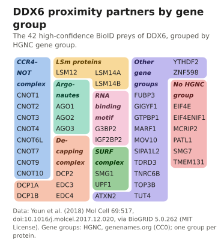
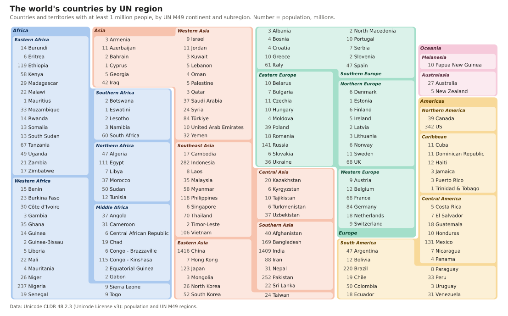
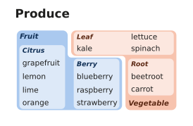
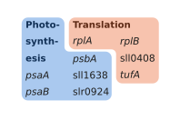

# Treemap tour


<!-- WARNING: THIS FILE WAS AUTOGENERATED! DO NOT EDIT! -->

An Euler diagram shows how sets **overlap**. An itemized treemap shows
how one set **divides**: proteins into complexes, countries into
regions, files into folders. Each member gets one cell with its name in
it, each group (at every level) is one rounded shape, and the whole map
is a rectangle, so the figure is also the lookup table.

## A first treemap

The proximity partners of the RNA helicase DDX6, grouped by gene family:

``` python
from itemiset import treemap

lay = treemap.plot(**treemap.load_example("ddx6"))
lay
```



Each group is one shape in its own colour, with its name (the header) in
heavier coloured text. Headers sit along the top or bottom edge of their
group where a whole row is free, so names are never beside them. The two
pooled groups go last: proteins that are the only partner from their
gene group, and proteins HGNC has not put in any group.

## Two levels, and numbers

Groups can nest. Here countries are grouped by continent and then by
subregion, and each carries a number, its population in millions, set in
grey before the name and lined up in its own column:

``` python
lay = treemap.plot(**treemap.load_example("countries"))
lay
```



Subgroups are lighter panels inside their parent’s colour. Neighbouring
continents never share a colour.

## Your own data

[`plot`](https://adamcc.github.io/itemiset/euler/render.html#plot) takes
a table with one row per item: a column of names, one column per level
of grouping (top level first), and optionally a column of numbers. A
pandas `DataFrame`, a list of dicts, or the path to a CSV, TSV or Excel
file all work.

``` python
produce = [dict(kind="Fruit", sub="Citrus", item=i) for i in ["lemon", "lime", "orange", "grapefruit"]] + \
          [dict(kind="Fruit", sub="Berry", item=i) for i in ["strawberry", "blueberry", "raspberry"]] + \
          [dict(kind="Vegetable", sub="Root", item=i) for i in ["carrot", "beetroot"]] + \
          [dict(kind="Vegetable", sub="Leaf", item=i) for i in ["spinach", "lettuce", "kale"]]
treemap.plot(produce, levels=["kind", "sub"], name="item", title="Produce")
```



Save the figure by giving a file name; the format follows the extension.
In SVG and PDF the names stay as text you can edit:

``` python
tmp = Path(tempfile.mkdtemp())
treemap.plot(produce, levels=["kind", "sub"], name="item", out=tmp/"produce.svg")
assert ">grapefruit</text>" in (tmp/"produce.svg").read_text()
```

## Options

**Header text.** `labels` maps group names to shorter headers. If a
header must go on two lines, a soft hyphen (`"­"`) inside a word marks
where it may break; it is invisible otherwise.

**Small groups.** `min_group=3` pools subgroups with fewer than three
items into one “other” subgroup. `last=("Other", ...)` puts the named
groups at the end; otherwise groups go largest first.

**Slant.** Gene names follow different rules in different organisms
(bacterial genes are italic, human protein symbols are not), so the
slant is yours to set: `item_style="italic"`, or a function giving each
name its own, such as italic gene symbols with roman locus tags. Headers
take the opposite slant to most names unless you set `header_style`.

``` python
import re
genes = [dict(process="Photosynthesis", gene=g) for g in ["psaA", "psaB", "psbA", "sll1638", "slr0924"]] + \
        [dict(process="Translation", gene=g) for g in ["rplA", "rplB", "tufA", "sll0408"]]
locus = re.compile(r"^s[ls][lr]\d{4}$")    # Synechocystis locus tags stay roman
treemap.plot(genes, levels="process", name="gene",
             item_style=lambda it: "normal" if locus.match(it.name) else "italic")
```



**Fonts.** The default is matplotlib’s DejaVu Sans; `font="Inter"` (or
any installed font) changes it. `fontsize` sets the names’ size; headers
follow it.

**Shape.** `target_aspect` is the width-to-height ratio to aim for
(default 1.6).

## Checking a layout

Every layout keeps the same guarantees, and
[`check_layout`](https://adamcc.github.io/itemiset/euler/layout.html#check_layout)
reports them:

``` python
lay = treemap.plot(**treemap.load_example("countries"))
treemap.check_layout(lay)
```

    {'Every item placed once': True,
     'One cell per item and header cell': True,
     'Each group is one piece': True,
     'Each header is one block of its size': True,
     'All cells on the grid': True}
